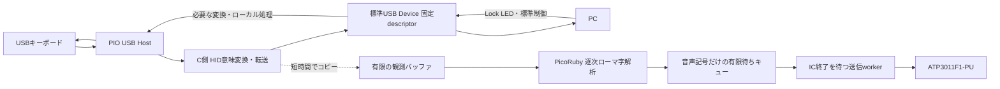

# USB HID中継器・ローマ字読み上げPoCの構成

本資料は **PoC（実現性を確かめる試作）** の設計メモであり、汎用製品の完成や、あらゆる機種・環境での完全互換を要求しない。調査日: 2026-10-11。レビューに基づく設計を実装し、新規回路の接続データ・図、専用コード、PicoRuby Patch列を用意した。ホストテストとクリーンなPatch適用からのUF2ビルドを実施。実機検証は未実施。

実装の入口は[PoC資料](../hid-relay/README.md)。本資料は設計意図を残し、具体的な実装・数値・未対応項目は[実装説明](../hid-relay/implementation.md)と[検証結果](../hid-relay/validation.md)を参照する。

作業場所: `.worktree/usb-keyboard-hub`、ブランチ: `research/usb-keyboard-hub`。実装は意味単位でコミットし、ドキュメントは最後にまとめる。既存の指定パス `docs/todo/hub_architecture.md` を維持する。

## 1. PoCの目的と確定事項

キーボードとPCの間に **USB HID中継器（HIDプロキシ／ブリッジ）** を置き、通常のキー入力をPCへ届けながら、入力のコピーからローマ字を認識して **ATP3011F1-PU** で読み上げる。

| 項目 | 採用する方針 |
|---|---|
| ハードウェア | Raspberry Pi Pico 2 W＋ATP3011F1-PU。回路はUSB・電源・音声部を含めて新規設計 |
| ソフトウェア | PicoRubyと専用のC拡張・Rubyコード。前回の検証スクリプトは使わない |
| 初回検証環境 | US配列キーボード＋Mac（macOS）。キーボード機種とmacOSバージョンは未定 |
| USB方式 | A案: PC側はPico標準USB Device、キーボード側はPIO USB Host |
| PC側descriptor | 固定descriptorでキー入力の意味を保持して再構成 |
| 対応範囲 | A: 基本入力、B: 対象キーボードの標準HID入力。通常のLock LED等の制御も扱う |
| 対象外 | VIA/Remap、RGB設定、メーカー固有カスタム機能、専用更新プロトコル、任意USB機器の完全透過 |
| 最優先 | キーボード→PCのリアルタイム転送。音声処理で待たせない |
| 読み上げ | 実際のローマ字押下列のみ。IME・文脈・編集結果・抑揚調整は扱わない |
| 解析のタイミング | 解釈でき次第確定。曖昧な末尾だけ短く保持して後続を待つ |
| 発話のタイミング | ICが空いていれば送信。発話中は終了を待ち、割り込ませない |
| メモリ | 有限の小さなバッファ。処理済みの生入力や送信済みデータを順次解放し、履歴は保存しない |
| 音声バッファ満杯時 | 新しい読み上げ分を破棄する。既存の待機分とPCへの転送は維持 |
| PicoRubyへの変更 | 意味単位の番号付きPatchファイルとして提供し、順次適用後にビルド可能にする |

前回の回路とコードはIC動作確認用の独立した実験であり、今回の新規設計の制約・実装の土台にはしない。既存の検証用ファイル自体は変更・削除しない。

**実現可能と判断するが、統合実機で確認済みではない。** RP2350の標準USBは1系統なので、PIO USBを追加してHostとDeviceを同時に動かす。[S1][S2] 他のホストICや2マイコン案の比較は今回のPoCでは行わない。

## 2. データ経路と優先順位

USB転送はC側で進め、PicoRubyの解析・GC・I²C・発話終了待ちを転送の条件にしない。観測用コピーも待ち合わせをしない。PC→キーボードの標準制御はC側で処理し、必要なLock状態だけ解析側に通知する。

読み上げ側が無視するBackspace・ショートカット・長押し等も、**PCへの転送では無視しない**。キーをASCIIへ変換して再入力する方式は使わず、押下・解放・修飾キーの意味を保つ。

## 3. 転送対象はA・Bと通常のキーボード制御

| 範囲 | PoCで扱う内容 |
|---|---|
| A: 基本キーボード入力 | 通常キー、修飾キー、押下・解放、同時押し、Backspace、ショートカット。まず6KROで動作確認 |
| B: 標準HIDの追加入力 | 対象機種のNKRO、複数Report ID/interface、メディア・システムキー。マウス一体型を試す場合はその標準入力も対象表に追加 |
| 通常の逆方向制御 | Caps/Num/Scroll Lock等のLED、必要なHIDクラス要求、接続・切断・通常の休止復帰 |
| 対象外 | VIA等の設定機能、メーカー固有Feature、RGB制御、ファームウェア更新通信、USB機器一般の透過 |

旧資料のC（カスタム機能等）・D（任意機器の完全透過）は対象外。LEDはCと一緒に除外せず、通常のキーボード機能として扱う。

「一般的なカスタム不可能なキーボードの機能」を保つことが目的であり、PoCでは実際に接続する機種の機能を一覧にして確認する。多数の機種を網羅する互換性試験を着手条件にしない。6KROでの成功とNKROの実証は区別し、未検証機能は未検証と記録する。

### 採用方式: 固定descriptorで意味を保って再構成

PCには本装置の固定したキーボードdescriptorを提示する。下流のReport Descriptorに従って入力を解釈し、Usage・押下状態をPC側形式へ変換する。NKROやConsumer/System Controlは必要な表現を固定descriptorへ組み込む。固定descriptorは「常に6キーだけ」を意味しない。

**固定descriptorでもCapsLock等のLEDは機能させられる。** PC側にLED Output reportを定義し、受信したLED状態を下流キーボードのOutput形式へ変換して送ればよい。既存PicoRubyはLED状態を保存するだけなので、この下流送信はパッチで追加する。[L1][L2][S7] 動かない場合はまずOutput形式・Report ID・送信経路を調べ、固定descriptor方式そのものを変更する必要があるとは考えない。

転送キューは短い押下→解放も順に保持する。送信APIの失敗を無視したり、常に最新状態だけで上書きしたりしない。

## 4. 新規回路: Pico 2 W＋PIO USB Host

A案を採用する。PC接続は標準USB端子、キーボード接続はPIO USB用GPIOとUSB-A端子、音声部はATP3011とアンプ・スピーカーで構成する。PicoRubyはソフトウェア基盤であり、ハードウェア部品とは区別する。

### 新しく決める配線とビルド条件

- PIO USBのD+/D−、ATP3011のI²C・RESET、VBUS制御等のピンを一つの回路図で割り当てる。前回のGPIO割り当てやアンプ回路は固定条件にしない。
- Pico-PIO-USBのRP2350対応を利用し、PicoRuby・SDK・TinyUSB・PIO USBのコミットを固定する。公開Host/Device例は足場であって、そのままキーボード中継器にはならない。[S2][L4]
- 参照したTinyUSB初期化はPIO USB使用時に120 MHzへ設定する。採用版の要求に従い、PicoRubyのtick等との整合を確認する。[L4]
- PIO/SM/DMA/IRQ/core/stackの割り当てを決める。初期PoCではWi-Fi/BLE/PSGを無効化する構成とし、USBに必要な資源を優先する。CYW43のPIO/DMA、PSGのcore1利用を起動処理も含めて確認する。[L5]
- 対象はPIO USBで扱うFull Speed / Low Speedのキーボード。High Speedや8 kHz動作の維持は今回のPoCの対象にしない。[S2]

### ブレッドボードと給電

- キーボードのVBUSは5 V、Picoの信号GPIOは3.3 Vとして区別し、GPIOからキーボードへ給電しない。
- PCからの給電で全体を賄えるか、Pico・キーボード・ATP3011・アンプの電流を見積もる。外部給電が必要ならPC側への逆流を防ぐ。電源同士を単純に並列接続しない。
- 下流VBUSの電流制限・保護と、PicoのVBUS/VSYSの関係を回路図に示す。PoCであっても短絡・逆給電対策は省かない。
- 既存USB descriptorの100 mA申告をそのまま使わず、設計した電源条件と合わせる。[L1]
- USB配線は短くし、長いジャンパや分岐を避ける。必要ならUSBコネクタ周辺のみ小基板を使い、I²C・音声部はブレッドボードに置く。抵抗・保護素子はPIO USBの推奨回路を確認して選ぶ。
- ATP3011の動作電圧、I²Cプルアップ、リセット、デカップリング、音声出力のフィルタ・アンプ・スピーカーを新規設計する。[L6] 発声中の電源変動でUSBが不安定にならないか確認する。

## 5. PicoRubyの不足機能とPatchの提供方針

ローカル調査のPicoRubyは `371d176f1bfd834d18ff2a8c86d2667b51b0fd32`、同梱TinyUSBは `86ad6e56c1700e85f1c5678607a762cfe3aa2f47`。以下はこの固定版の調査結果であり、最新版全般への断定ではない。

| 現状 | 必要な追加 |
|---|---|
| R2P2はDevice構成で、Host stackの組み込みがない | PIO USB Host、ビルド依存、初期化、HID受信 |
| Rubyのkeyboard_sendは単一キー、C側は6キー、HID bufferは16バイト | 対象のA/B入力を表現する固定descriptor、レポート変換・転送 |
| 既存HID IN intervalは10 ms | PoCの入力間隔・追加遅延を測り、必要な設定へ変更 |
| SET_REPORTはLED状態保存のみ | PCから受けたLock LEDを下流へ送る処理 |
| KeyboardクラスはGPIOのキーマトリクス向け | USB Host入力と観測APIを別に設計 |
| MachineのUSB pumpは所有・再入防止が前提 | Host/Deviceの実行文脈、IRQ/core間キューの統合 |

根拠: [L1]–[L5]はパッチ適用前の調査。拡張は `patches/picoruby-hid-relay/` 以下へ意味単位で分け、以下の4本を作成済み。全件の順次適用からUF2生成まで確認した。

| 適用順・ファイル名 | 一つの変更単位 |
|---|---|
| 0001-dual-usb-build.patch | 依存版固定、CMake・Host設定・PoC用ビルド構成 |
| 0002-hid-report-core.patch | 有限長descriptor解析、標準入力とLED形式変換 |
| 0003-hid-relay-runtime.patch | Host/Device初期化、USB pump、固定descriptor、転送・LED・観測バッファ |
| 0004-ruby-observation-api.patch | PicoRuby取得API、欠落通知・統計 |

Patch列は累積適用を前提とし、番号順は `series` に記載する。適用ツールが全件を事前検査してから作業コピーへ適用する。

提供する手順は、固定したPicoRubyのクリーンな作業コピーの準備、submodule・PIO USB依存の取得、各Patchの `git apply --check` と適用、PoC構成のビルド、UF2生成・書き込みまでを含める。READMEと適用順リスト、依存コミットを同梱し、新しい作業コピーへの順次適用からビルドを再現して検証する。既存の研究用チェックアウトを手作業で直しただけの状態を成果物にしない。

ローマ字パーサと専用ATP3011制御は装置用コードとして管理する。PicoRuby本体への変更が必要な部分だけPatchへ含め、前回の標準入力スクリプトを埋め込まない。

### 実行責務

C側はUSB受信・送信・標準制御と短時間のコピーを担当する。callback内でRuby、長いI²C待ち、ブロッキングログを実行しない。送信完了まで必要なUSBバッファの寿命を守る。

PicoRuby側は観測イベントを逐次解析し、音声記号へ変換する。IC制御は専用workerとし、ICの発話完了を確認してから次を送る。I²Cの状態問い合わせはIC指定の間隔を守る。[L6] Ruby Taskを分けただけで独立したとはみなさず、GCやC拡張の待ちがUSB処理を止めないことを測る。

## 6. ローマ字を逐次解釈して読む

### 確定済みの扱い

| 入力・状態 | 読み上げ側の動作 |
|---|---|
| 解釈可能なローマ字 | 確定できた部分から即座に音声記号へ変換。Enterや単語・文章の完成を待たない |
| n、h等を含む未確定の並び | 小さな末尾バッファと短い待ち時間で後続を待ち、読みの区切りを推測 |
| Backspace/Delete/カーソルキー | 無視する。前に打ったローマ字を編集・削除・巻き戻ししない |
| ショートカット | 読み上げ側では無視する。Ctrl/Alt/GUI等を伴う操作から文字を追加せず、PCには通常どおり転送 |
| 長押し | リピートを生成しない。最初の押下のみを扱い、同じ状態のreportで繰り返し発話しない |
| パスワード欄 | 検出・ミュートを実装しない。ローマ字として解釈できれば通常どおり読み上げる |
| 発話中の後続入力 | ICの発話終了まで送信を待つ。解析・音声記号化は進め、未送信分だけ有限キューへ保持 |

無視した編集キーによって未確定候補を書き換えない。短い待ち時間の経過自体は通常どおり扱う。例えば `ka` の後のBackspaceで「か」の発話を取り消すことはしない。

### パーサのPoC方針

- 初回PoCはUS配列で新規押下を文字へ変換し、英字の大小は読み上げ用に正規化する。元のキー状態はUSB転送で変更しない。JIS対応・配列切り替えは初回検証の必須条件にしない。
- ローマ字規則を表で持ち、`shi/si`、`chi/ti` 等の対応を定める。ICへはそのままのキー列ではなく、ICが受け付ける音声記号列と終端を生成する。抑揚等の指定は追加しない。
- `n` と後続母音、`sh`/`ch`/`hy`等の継続可能な並びを有限状態で保持する。曖昧さは単一文字だけでなく接頭辞全体で判断する。
- 短い待ち時間の仮値は50 msとし、実際の打鍵で調整する。これは採用確定値ではない。タイムアウト時に有効な読みがある末尾は確定し、単独の子音など読めない末尾は破棄する。ゆっくり打つと読みが分かれることはPoCの許容限界として記録する。
- 待ち時間は観測した押下時刻を基準に扱う。Ruby処理が遅れたことだけで、既に到着している後続文字を見ずにタイムアウトしない。
- 空白や記号は区切りとして未確定末尾を処理できるが、発話の必須トリガーにはしない。確定済み部分は消費し、接頭辞を重複して読まない。
- 同時report内で複数の新規押下がある場合は固定の順序で処理する。厳密な打鍵順が取れない場合の自然さは追求しない。
- ICが空いていれば最小の有効な発話単位から送る。ICが発話中なら確定した音声記号をまとめ、127バイト制限内の有効な区切りで送信する。ICの受付制約・CR終端を守る。[L6]

「解析は可能な限りリアルタイム」と「音声出力はICが空くまで遅れる」を区別する。単語ごとの自然な読み、英単語と日本語の識別、IME・文脈・アクセントは実装しない。

## 7. 質問への回答: 信号をそのまま流し、コピーだけ解析できるか

**キー操作やLED状態の意味を変えずに中継し、コピーだけをPicoRubyで解析することは可能。一方、今回のHost＋Device・固定descriptor方式では、USB信号や全通信バイトを無加工で両方向へ流すことはできない。** この区別はVIA等を除外しても残る。

PCと中継器、中継器とキーボードは別々に列挙されるUSB接続になる。アドレス・endpoint・ポーリング・転送完了はそれぞれの接続で管理する。さらに固定descriptorを採用するため、下流のreport形式とPC側の形式が一致するとは限らない。

| 通信 | PoCで必要な扱い |
|---|---|
| キーInput | Usageと押下状態を維持して固定形式へ変換。同じ形式ならreportのコピーも可能だが、任意形式へは無条件コピーできない |
| Lock LED Output | PCが指定した状態を保持し、下流のLEDビット配置・Report IDへ変換して送る。値の意味は変えない |
| GET_DESCRIPTOR / SET_ADDRESS等 | 中継器が自分のUSB接続について応答・処理。PCの要求を下流へ丸投げしない |
| SET_PROTOCOL | PC側のBoot/Report形式を切り替える。下流の使用形式は別管理し、必要な変換を行う |
| SET_IDLE / GET_REPORT等 | 本装置が提示したHID機能に対して処理する。適切な現在状態や送出条件を管理 |
| suspend/resume・wake | 接続ごとの状態管理が必要。キーボードの機能とPCの許可条件に合わせて必要な復帰動作を実装 |
| 抜去・再接続 | 古い押下状態を残さない。PC未接続中の入力を後からまとめて注入しない |

上記はHID仕様とHost/Device APIの役割に基づく設計上の判断。[S5][S7] **USBレベルの完全な同一性ではなく、通常のキーボードとしての機能的な再現を目指す**。標準的な入力、同時押し、メディアキー、Lock LED、通常の接続・休止復帰は実装対象にできる。機種名やUSB識別情報・タイミングまで直結時と同一になるわけではない。

Boot互換や休止復帰は通常機能として検証項目に残すが、PoCの基本中継・発話確認より先に全環境で完成させる必要はない。実機でできた項目と残った項目を記録する。メーカー固有制御の互換性や任意機種の保証に作業を広げない。

## 8. 有限バッファとデータの寿命

**処理したデータから順に捨て、入力履歴を持たない。** ただし、音声記号化した時点で「元のキー列」は消せても、ICが発話中なら「未送信の音声記号」は保持しなければ、次に読み上げられない。

| データ | 保持する最小範囲 | 解放するタイミング |
|---|---|---|
| USB転送report | 未送信・転送中のもの | 転送完了またはAPIが所有権を移した時点 |
| 観測コピー | Rubyがまだ処理していないイベント | パーサが消費した直後 |
| キー状態 | 新規押下の検出に必要な現在状態 | 次の状態で更新。履歴化しない |
| 未確定ローマ字 | 続きを待つ短い接頭辞 | 音声記号化、または解釈不能として処理した直後 |
| 確定した音声記号 | ICへまだ渡していない分だけ | 送信が成功し、IC側への引き渡しを確認した時点 |
| 発話中の本文 | 原則として保持しない | ICに渡した後はbusy/ready状態等だけ管理 |

ICが発話中でも生入力を長く貯めず、逐次変換して元データを解放する。文字列の全履歴、発話済み本文、ファイルへの入力ログは保存しない。容量は固定上限を設け、転送用と観測・音声用のメモリを分ける。ここでの「消す」はバッファ消費・参照解放であり、RAM全域の暗号学的な消去保証はPoCの対象ではない。

この方式でも、入力が発話を長時間上回れば未送信音声は蓄積する。処理済みデータの解放だけで解消するとはしない。満杯時は、ユーザー確認済みの方針として **新しい読み上げ分を破棄する（drop-new）**。既にキューにある未送信分と発話中の内容は維持し、PC転送は止めない。容量内の未送信分を時間経過だけで捨てる設計にはしない。

追加する音声記号の単位が空き容量に収まらなければ、その単位全体を破棄して消費済みとする。部分的に書き込んで音声記号を壊したり、破棄した分を別バッファへ退避して再試行したりしない。空きができた後の新しい単位から受付を再開し、保持済み分は順番に発話する。本文は残さず破棄数だけを診断用に数える。

観測イベントを失った場合は欠落を通知し、欠落前後を誤って一語に連結しないようパーサを再同期する。IC異常時のタイムアウト・音声停止もUSB転送とは独立させる。診断には本文でなく欠落数・キュー使用量・転送遅延を使う。

PoCで測るのは、直接接続比のキー転送遅延・欠落と、発話中やRuby高負荷でも転送が続くこと。音声の待ち時間自体に厳しい上限は設けない。物理バイパス、電源断時の透過保証、製品向けの自動復旧機構は今回の実装目標にしない。

## 9. 残る確認事項と実装TODO

方式の比較や製品仕様の再検討ではなく、PoCを作るための具体化に絞る。

### 確認済み事項と未定の実機情報

- [x] 初回はUS配列キーボードとMacで検証する。
- [x] 音声バッファ満杯時は新しい読み上げ分を捨て、既存の待機分とPCへの転送を維持する。
- [ ] キーボード機種は未定。決まり次第、機種名・descriptor・標準機能を記録する。
- [ ] 実機検証時にMacの機種とmacOSバージョンを記録する。

キーボード機種が未定でも、US配列・Macを前提にPoC設計を進める。

### 実装時に決めて検証すること

- [ ] 対象機種のdescriptorを取得し、A/B入力とLEDの必要項目を確認する。
- [x] 新規回路図、ピン割り当て、部品表、給電・VBUS保護を作成する（組み立て・実測は未実施）。
- [x] PIO USBの資源割り当て・USB pumpと固定descriptor中継を実装する（実機入力は未確認）。
- [x] PicoRuby向けPatchを意味単位で作り、適用順・固定依存版・ビルド手順を用意する。
- [x] ローマ字表と短い末尾待ち、IC用変換、専用workerを実装する。
- [x] 有限バッファの容量・消費タイミングと、満杯時のdrop-newを実装する。
- [ ] LED、NKRO、メディアキー等の標準機能を対象機種で順に確認する。
- [ ] Boot互換・再接続・休止復帰を試し、未対応や実機制約を記録する。

ミュート、パスワード判定、編集再現、抑揚、VIA、ケース設計、全機種の互換性表などをPoCの必須TODOに追加しない。

## 10. PoCの検証順序と成果物

1. 対象キーボードを直結して基本入力とLEDを確認し、descriptorと入力間隔を取得する。
2. A案の回路でPIO USB Hostと標準USB Deviceを同時動作させ、音声なしの中継を確認する。
3. 固定descriptorで通常キー・修飾・短い押下と解放・LEDを試す。必要なNKRO・メディアキーを追加する。
4. PicoRubyにコピーを渡し、ローマ字を逐次変換する。Backspace等を無視すること、長押しで読みを増やさないこと、曖昧な末尾の短い待ちをテストする。
5. 専用IC workerを接続し、発話終了を待って後続を送ること、処理済みデータが解放されることを確認する。
6. 発話中・連続打鍵・GC・IC通信異常・音声バッファ満杯でもPC入力を止めないか測る。満杯時は既存の待機分が順番に発話され、新しい超過分だけが破棄されること、空きができれば受付が再開することを確認する。
7. Patch列を新しい作業コピーへ順次適用してビルドを再現し、実機で確認した機能・未確認項目を記録する。

成果物は新規回路図・ブレッドボード配線と部品説明、順次適用できるPicoRuby Patch列、専用コード、ビルド・実行手順、PoC実測結果と制約。製品の完全完成ではなく、指定構成で中継とローマ字読み上げが両立することを示す。

## 11. 根拠と参照先

### Webの一次資料

既存調査は2026-10-11参照。HID仕様とTinyUSB HID資料は今回の双方向中継の回答にあたり再確認した。

- **[S1]** [Raspberry Pi RP2350製品仕様](https://www.raspberrypi.com/products/rp2350/): USB controller/PHYが1個、Host/Device対応。追加ポートを必要とする判断の根拠。
- **[S2]** [Pico-PIO-USB](https://github.com/sekigon-gonnoc/Pico-PIO-USB)、[同時Host/Device例](https://github.com/sekigon-gonnoc/Pico-PIO-USB/blob/main/examples/host_hid_to_device_cdc/host_hid_to_device_cdc.c)、[資源・ピン設定](https://github.com/sekigon-gonnoc/Pico-PIO-USB/blob/main/src/pio_usb_configuration.h): RP2350対応、FS/LS Host、GPIOポートとCの統合例。mainは可変で、採用時にコミットを固定する。
- **[S3]** [TinyUSB](https://docs.tinyusb.org/en/latest/): Host/Device stackの提供。R2P2にHost機能が組み込まれていることを意味しない。
- **[S5]** [USB-IF HID 1.11](https://www.usb.org/sites/default/files/hid1_11.pdf): §6–8、Appendix B/C/F。Report Descriptor、Boot protocol、キー配列の順序、ホスト側リピート、LED/クラス要求を確認。IME等を復元できないという判断は、HIDが送る情報とOS処理の分担からの推論。
- **[S6]** [HID Remapper](https://github.com/jfedor2/hid-remapper): USB入力中継の既存実装と複数ハードウェア案。今回の製品互換性の保証には用いない。

- **[S7]** [TinyUSB HID公式資料](https://docs.tinyusb.org/en/latest/reference/class/hid.html): descriptorに一致するreport、DeviceのOutput受信とHostのOutput送信、Boot/Report切り替え。最新版の説明であり、固定した同梱版でのAPI差分はパッチ実装時に照合する。

### ローカルで確認した固定コミット

PicoRubyは親チェックアウト `repositories/picoruby` を読み取り参照した。新しいworktree内へ複製・更新していない。以下のGitHubリンクは同じコミットへ固定する。

- **[L1]** PicoRuby [USB設定](https://github.com/picoruby/picoruby/blob/371d176f1bfd834d18ff2a8c86d2667b51b0fd32/mrbgems/picoruby-r2p2/include/tusb_config.h)、[descriptors](https://github.com/picoruby/picoruby/blob/371d176f1bfd834d18ff2a8c86d2667b51b0fd32/mrbgems/picoruby-r2p2/ports/rp2040/usb_descriptors.c)、[CMake](https://github.com/picoruby/picoruby/blob/371d176f1bfd834d18ff2a8c86d2667b51b0fd32/mrbgems/picoruby-r2p2/cmake/CMakeLists.txt)、[pico2_w構成](https://github.com/picoruby/picoruby/blob/371d176f1bfd834d18ff2a8c86d2667b51b0fd32/build_config/r2p2-picoruby-pico2_w.rb)。
- **[L2]** [Ruby HID binding](https://github.com/picoruby/picoruby/blob/371d176f1bfd834d18ff2a8c86d2667b51b0fd32/mrbgems/picoruby-usb-hid/src/mruby/usb-hid.c)、[HID RP2 port](https://github.com/picoruby/picoruby/blob/371d176f1bfd834d18ff2a8c86d2667b51b0fd32/mrbgems/picoruby-usb-hid/ports/rp2040/usb-hid.c)、[Keyboard](https://github.com/picoruby/picoruby/blob/371d176f1bfd834d18ff2a8c86d2667b51b0fd32/mrbgems/picoruby-keyboard/mrblib/keyboard.rb)。
- **[L3]** [Machine RP2 portのUSB pump](https://github.com/picoruby/picoruby/blob/371d176f1bfd834d18ff2a8c86d2667b51b0fd32/mrbgems/picoruby-machine/ports/rp2040/machine.c)。
- **[L4]** 同梱TinyUSB [Host HID / Device CDC例](https://github.com/hathach/tinyusb/blob/86ad6e56c1700e85f1c5678607a762cfe3aa2f47/examples/dual/host_hid_to_device_cdc/src/main.c)、[RP2初期化](https://github.com/hathach/tinyusb/blob/86ad6e56c1700e85f1c5678607a762cfe3aa2f47/hw/bsp/rp2040/family.c)、[CMake](https://github.com/hathach/tinyusb/blob/86ad6e56c1700e85f1c5678607a762cfe3aa2f47/hw/bsp/rp2040/family.cmake)、[Host HID API](https://github.com/hathach/tinyusb/blob/86ad6e56c1700e85f1c5678607a762cfe3aa2f47/src/class/hid/hid_host.h)。
- **[L5]** [PicoRuby PIO port](https://github.com/picoruby/picoruby/blob/371d176f1bfd834d18ff2a8c86d2667b51b0fd32/mrbgems/picoruby-pio/ports/rp2040/pio.c)、[PSG core1使用箇所](https://github.com/picoruby/picoruby/blob/371d176f1bfd834d18ff2a8c86d2667b51b0fd32/mrbgems/picoruby-psg/ports/rp2040/psg_port.c)。CYW43のPIO/DMA確保は同梱SDKの `src/rp2_common/pico_cyw43_driver/cyw43_bus_pio_spi.c` で確認。
- **[L6]** [AQUESTデータシート](https://www.a-quest.com/archive/manual/atp3011_datasheet.pdf)。新規回路と専用IC制御の設計根拠。前回の検証回路・スクリプトは引き継がない。
